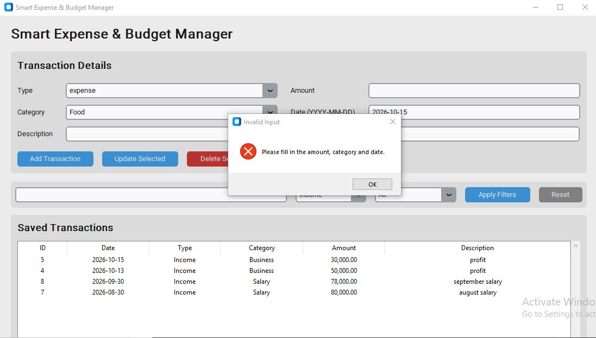

# Smart Expense & Budget Management System

## Project Overview

The Smart Expense & Budget Management System is a Python desktop
application designed to help individuals, students and small business
owners record, manage and analyse their income and expenses.

## Project Problem

Many individuals, students, and small business owners do not have a
simple and organized way to record and monitor their income and expenses.

Financial transactions are often recorded inconsistently or kept in
different places such as notebooks, phone notes, spreadsheets, or
messages. This makes it difficult to know how much money is being spent,
where the money is going, and whether spending is within a planned budget.

As a result, users may struggle to identify unnecessary spending,
calculate their monthly financial position, and make informed budgeting
decisions.

The Smart Expense & Budget Management System will provide a user-friendly
Python desktop application that allows users to record, categorize,
search, and analyse their financial transactions.

## Project Objectives

- Record income and expenses
- Categorize financial transactions
- Store transaction history using SQLite
- Calculate monthly income and expenses
- Provide category-based spending summaries
- Compare budgets with actual spending
- Search and filter transactions
- Export transaction data to CSV
- Provide a simple visual dashboard
- Validate user input and display clear error messages

## Target Users

- Students
- Individuals
- Small business owners

## User Stories

### Transaction Management

- As a user, I want to record an income transaction so that I can keep
  track of money coming into my account.

- As a user, I want to record an expense so that I can keep track of
  where my money is going.

- As a user, I want to edit a transaction so that I can correct
  information I entered incorrectly.

- As a user, I want to delete a transaction so that I can remove
  incorrect or unwanted records.

### Categories

- As a user, I want to categorize transactions so that I can understand
  how my money is being spent.

- As a user, I want categories such as Food, Transport, Bills, Business,
  Salary and Other.

### Search and Filtering

- As a user, I want to search for transactions so that I can quickly
  find a specific financial record.

- As a user, I want to filter transactions by category, date or type
  so that I can analyze specific records.

### Reports and Budgeting

- As a user, I want to see my monthly income and expenses so that I can
  understand my financial position.

- As a user, I want to see spending by category so that I can identify
  where most of my money goes.

- As a user, I want to compare my budget with my actual spending so that
  I can control my expenses.

### Export and Dashboard

- As a user, I want to export my transactions to CSV so that I can use
  my financial data in other applications.

- As a user, I want to see a visual dashboard so that I can understand
  my financial information quickly.

### Validation

- As a user, I want the application to show clear error messages when
  I enter invalid or incomplete information.

## Main Features

- Add transactions
- Edit transactions
- Delete transactions
- Search transactions
- Filter transactions
- Income and expense categories
- Persistent SQLite database
- Monthly financial summaries
- Category summaries
- Budget-vs-actual analysis
- CSV export
- Visual reports
- Input validation

## Categories

The application will include categories such as:

- Food
- Transport
- Bills
- Business
- Salary
- Other

## Technologies

- Python
- CustomTkinter
- SQLite
- SQL
- CSV
- Pandas
- Matplotlib
- Git
- GitHub

## Project Status

The Smart Expense & Budget Management System has been developed with core features for transaction management, SQLite database storage, monthly financial summaries, category analysis, budget-versus-actual calculations, CSV export, and a dashboard with charts. Testing has been performed on these features, with the reported results passing. Further documentation and final verification are ongoing.

## Testing

The Smart Expense & Budget Management System was tested to check its main features and functionality.

Test Area| Result
SQLite database storage and persistence| PASS
Monthly totals calculation| PASS
Category summaries| PASS
Budget versus actual spending| PASS
CSV export| PASS
Dashboard and charts| PASS
Editing transactions| PASS

Additional Testing

Further checks should cover adding and deleting transactions, searching and filtering records, invalid amounts, empty required fields, and database persistence after restarting the application.

## CustomTkinter GUI Screenshots

### Transaction Entry Form

### Saved Transactions

## Latest GUI Screenshots

### 1. Search and Filters
This screenshot shows the search field and filters for transaction type and category.

### 2. Edit, Delete and Validation
This screenshot shows the transaction management interface.

## Financial Dashboard and Charts

The application includes a visual dashboard for reviewing monthly financial performance.

### Monthly Financial Dashboard

Installation and Setup

1. Clone the Repository

git clone https://github.com/FAVOUROMANG3/smart_expense_tracker.git
cd smart_expense_tracker

2. Create a Virtual Environment

python -m venv .venv

3. Activate the Virtual Environment

Windows:

.venv\Scripts\activate

4. Install Dependencies

python -m pip install --upgrade pip
pip install -r requirements.txt

5. Run the Application

Run the application's entry-point Python file from the project root directory.

Replace "main.py" below with the actual filename if your entry point has a different name.

python main.py

Troubleshooting

- Ensure Python is installed and available from your terminal.
- Activate the virtual environment before installing dependencies or running the application.
- If a module is missing, check that it is listed in "requirements.txt".
- If the application fails to start, review the error message in the terminal.